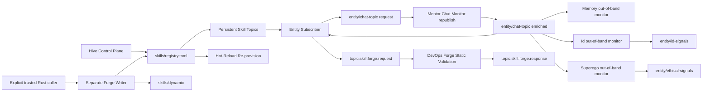

# Architecture: Skill Topology and Forge

**Status:** Canonical specification  
**Version:** 1.4

**Date:** 2026-10-19

This document is the single source of truth for skill topology provisioning and Forge orchestration across the Sovereign stack.

## 1. Purpose

Define a stable runtime model where:

- Skill topology is provisioned as persistent request/response topics at startup.
- Registry ownership, runtime execution, and Forge authoring are separated by clear boundaries.
- Superego-style safety gates are enforced as policy boundaries, not ad hoc prompt logic.
- Hot-reload updates topology safely on `registry.toml` changes.

## 2. Canonical Topology Model

For each enabled skill in `skills/registry.toml`, runtime MUST provision:

- `topic.skill.{name}.request`
- `topic.skill.{name}.response`

Where `{name}` is a topic-safe form of the registry skill ID.

Each provisioned skill has:

- A dedicated consumer group: `skill-worker.{name}`
- An isolated subscriber worker bound to the request topic
- A deterministic response topic for tool/result envelopes

Provisioning is idempotent and safe to run repeatedly.

## 3. Separation of Concerns

### Hive (control plane)

- Owns provider secrets and authoritative policy controls.
- Publishes system-level configuration and registry artifacts.
- Does not execute per-skill work loops directly.

### Registry (contract plane)

- `skills/registry.toml` is the declarative skill topology contract.
- Declares enabled skill IDs and instruction mappings.
- Is the only source used for persistent topic provisioning.

### Entity Subscriber (runtime plane)

- Provisions persistent skill topics from the registry at startup.
- Runs skill workers as isolated subscribers.
- Handles request/response message execution flow.

### Monitors (out-of-band plane)

- Subscribe to chat-topic envelopes without blocking completion path.
- Mentor chat monitor intercepts request envelopes, injects constitutional preprompt context, and republishes enriched envelopes.
- Passive Memory/Id/Superego observers consume enriched envelopes and publish side-channel signals.
- Include mentor chat monitor and passive Id/Superego/Memory observers.

### Forge (proposal validation and separate host authoring)

- The DevOps Forge broker validates proposed code and markdown without writing skill or registry artifacts.
- `builtin.skill_factory` retains its separate create/delete authoring tools; the broker boundary does not govern that path.
- The direct `process_forge_request` writer requires `ForgeWriteAuthorization` from a trusted Rust caller and writes artifacts through sandbox checks and the registry contract. This non-deserializable parameter is not authentication; no runtime host approval route is connected to it.

## 4. Forge Pipeline (Canonical)

1. Intent classification identifies a persistent capability need.
2. Entity publishes code + markdown envelope to `topic.skill.forge.request`.
3. DevOps Forge worker checks strict JSON, byte/field bounds, identifiers, and static Superego patterns. Unknown fields, including `mentor_approved`, permissions, scores, and adoption flags, are rejected.
4. Worker publishes a bounded diagnostic and `topic.skill.forge.response`. Passing proposals receive `status=validated`, `applied=false`, `fitness_evaluated=false`, and `hot_reload_triggered=false`.
5. No skill or registry writes follow from broker validation. The worker holds no skills-root write capability.

Validation does not compile or execute code, establish behavioral gain, or authorize application. Host-owned baseline comparisons, no-gain/regression rejection, authenticated application, and adoption/rollback records remain gaps. A model's claimed score or improvement cannot fill them.

An explicit trusted host caller can still use the separate writer to save code/markdown under `skills/dynamic/`, mirror instructions, and touch `skills/registry.toml`. Its hot-reload flag records the registry touch, not a watcher acknowledgement or proof that the skill is usable. This helper is not a broker adoption path.

New Forge and memory subscriber diagnostic records contain only fixed outcome codes and bounded byte counts. They omit source content, identifiers, and freeform error text. Historical log entries are unchanged.

## 5. Superego Gates (Policy Boundaries)

The following are policy requirements for mutation/execution boundaries; the validation-only broker does not implement an authenticated approval or fitness gate. Its static pattern scan is not proof of code safety.

- **Gate A: Registry mutation**
  Require elevated approval for high-risk additions (shell/network-wide/system scope).
- **Gate B: Permission expansion**
  Block or require approval when a forged skill broadens permissions unexpectedly.
- **Gate C: Runtime execution**
  Apply risk/interception policy before executing high-risk tool calls.
- **Gate D: Secret access**
  Restrict secret namespaces; inject only what a declared skill requires.

Gate outcomes:

- `allow`
- `allow_with_audit`
- `require_mentor_approval`
- `deny`

## 6. Hot-Reload Rules

Watcher behavior MUST include:

- Skill artifact changes (`skill.toml`, `*.json`) for runtime registration updates.
- `registry.toml` changes for topology re-provisioning.

On registry change:

1. Cancel existing persistent worker subscriptions.
2. Re-parse enabled skills from registry.
3. Re-provision topics and worker subscriptions.
4. Emit operational logs/events for traceability.

On registry removal:

- Cancel active topology workers and enter degraded mode until registry is restored.

## 7. Operational Invariants

- No dynamic-only runtime assumption is allowed in architecture docs or planning artifacts.
- Persistent topology is startup- and registry-driven, not message-driven.
- Registry is authoritative for skill topology scope.
- Applied skill artifacts must be reflected in the registry contract; validated proposals are not applied artifacts.
- Re-provision must be safe under repeated or bursty file events.

## 8. Diagram

